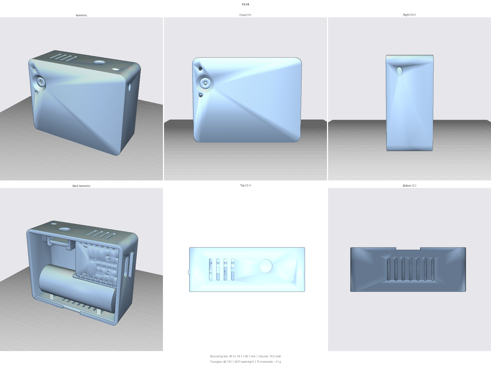

# kukucs

A one-button keychain camera built on the Seeed XIAO ESP32-S3 Sense ("kukucs" is Hungarian for peekaboo).
It sleeps all the time, wakes for one click, and serves its photos from its own Wi-Fi hotspot.



## Features
- Deep sleep between shots; short press = photo (~1 s shutter lag), with a small thumbnail for the gallery.
- Long press = Wi-Fi hotspot with a phone gallery that pops up by itself: grid, full-screen view with swipe,
  select several photos to save as one zip or delete, a remote **Take photo** button, auto-refresh.
- Photos named by date (`kukucs_2026-11-04_191502.jpg`): the phone sets the camera's clock when the gallery opens.
- microSD card when one is in, internal flash otherwise; photos move to the card once one appears.
- USB drive mode: plugged into a PC, a short press shows the card as a drive.
- Camera sensor put into standby before sleep; the orange LED flashes as a heartbeat in hotspot mode and after each photo.
- A 3D-printable case (CadQuery), checked for collisions against Seeed's official board model.

## Hardware
- Seeed Studio XIAO ESP32-S3 Sense (with camera and its Wi-Fi antenna; without the antenna the range is a few cm)
- 3.7 V LiPo, here a salvaged 850 mAh cylinder cell, Ø15 × 40 mm, soldered to the XIAO's BAT pads (it charges over USB-C)
- A small tactile switch (here a salvaged 10 × 10 mm board), between **D1 (GPIO2)** and **GND**;
  the internal pull-up is used, nothing else needed
- Optional: microSD card, FAT32

## Use
- **Short press**: takes a photo, back to deep sleep.
- **Long press (2 s)**: starts hotspot `kukucs` / password `kukucs123` (**change it** in `src/main.cpp` before you
  carry the camera around). The gallery pops up on the phone, or open http://192.168.4.1.
  If downloads don't start in the popup, open the address in the normal browser.
- In hotspot mode: a **short press** (or **Take photo** on the page) still takes a photo; a **long press** ends it.
  It also ends by itself after 2 min with no phone connected, or 5 min without page loads.
- **USB drive**: plug into a PC, then short press → the SD card shows up as a drive (no card: takes a photo instead).
  Eject or unplug → sleep.
- **LED** (inside the case, seen through the USB-C slot): short flash every 2 s = hotspot on; one longer flash = photo saved.
- Plugging in / reset just goes straight to sleep.
- Without a set clock (after the battery ran flat) photos are named `kukucs_00042.jpg`. The clock drifts a few
  minutes a day in deep sleep and is corrected on every gallery visit.

## Storage
- **microSD card in** (FAT32 only, exFAT is not supported; cards up to 32 GB come as FAT32): 1600×1200 photos.
- **No card**: photos go to internal flash at 800×600 (about 30 fit). The gallery shows an orange
  "No SD card · internal memory" badge. Once a card is in, these photos move to it the next time you open the
  gallery or the USB drive (each is deleted from flash only after it is safely on the card).
- The card is checked on every wake, so it can be swapped any time.
- Format a big card on Linux (erases it, check the device name first): `sudo mkfs.vfat -F 32 -n KUKUCS /dev/sdX1`

## Build & flash
```bash
pipx install platformio
```
| Environment | Notes |
|---|---|
| `xiao` (default) | the camera |
| `test` | never sleeps; serial `s` = short press, `l` = long press, `d` = USB drive |

```bash
pio run -t upload
```
While the board is awake (hotspot, USB drive, or the `test` build), this flashes with no buttons: PlatformIO resets it
through the USB serial port (1200-baud trick). While it sleeps, start the hotspot first (long press), or hold
**BOOT**, tap **RESET** (only reachable with the SD card out), release BOOT, upload, press RESET.

USB runs on TinyUSB, so the board shows up as Seeed `2886:0056` (and as Espressif `303a:1001` while in flash mode).
On Linux both need a udev rule, e.g. in `/etc/udev/rules.d/99-esp32.rules`:
`SUBSYSTEM=="tty", ATTRS{idVendor}=="303a", MODE="0666"` and the same line with `2886`.
`pio device monitor` shows logs (and sends the fake presses in the `test` build); closing it no longer resets the board.

Zip writer self-test (host): see the top of `test/zip_selftest.cpp`.

SSID, password, resolution, timings are `#define`s at the top of `src/main.cpp`; the gallery page is `src/page.h`.

## Case
Current: `case/v4/` (CadQuery): v3 + room for wires at both battery ends. Vent slots exist but are off (`vents_on`).
Older: `v3/` (battery only fits with wires at one end), `v2/` (board ledge hits the battery, button glued),
`v1/` (OpenSCAD draft, lid collides). Print v4.

v4 files: `body.stl`, `lid.stl`, `cap.stl` (print orientation), `case_assembled.step`, `drawing.png` (dimensions).
Outside 48.2 × 38.1 × 19.7 mm. Positions come from Seeed's official 3D model. `check_fit.py` tests the board, battery,
button PCB, body, lid and cap against each other, plus the paths for putting the board and button in.

Change a number at the top of `case/v4/model.py`, then (needs `pip install cadquery`):
`python model.py` and `python check_fit.py "Seeed Studio XIAO-ESP32-S3-Sense.step"`.

Print: PLA, 0.2 mm layers, 3 walls, 15 % infill, no supports. Body front-face down, lid plate down, cap flange down.

Nothing is glued, so every part can move to a new case version:
1. Cap into the top hole from inside (its flange keeps it in).
2. Button PCB, switch up, slides into its rails under the top wall from the back.
3. microSD card out. Board in from the back, shifted ~1.5 mm right, lens against the front wall;
   slide it left until the USB-C sits in its hole. Then push the card in through its slot from outside.
4. Battery into the cradle, wires to the XIAO's back pads. Antenna FPC stuck inside the lid.
5. Snap the lid on: its key locks the board's right end, its tab locks the button PCB, its ribs press the board
   and battery forward. Fingernail notch at the bottom back edge to open it.

Wiring routes (checked in `check_fit.py`), all through the 2.5 mm gap between the XIAO's back and the lid:
- Battery → BAT pads on the XIAO's back (BAT− is the pad nearest USB-C). The battery has a wire at each end: the right-end
  wire runs along the top-back of the battery to the left end, then both go up behind the board ledge.
- Shutter button → D1 and GND: solder the wires to the switch's two metal end tabs (front side; the salvaged
  board has no pads on the back) and cut the two traces leading away from the switch. The wires leave over the top
  of the button PCB towards the back (above the lowered lid tab), run behind the board **above** the lid key,
  and are soldered on the back face of the 2nd pin from the USB-C end (one on each long edge). Lid ribs and lip are
  cut away there so they don't press the joints.
- Antenna: plug it onto the u.FL before the board goes in; the cable leaves past the board's right end **below**
  the lid key, then the antenna sticks to the inside of the lid.

BOOT: paperclip through the small hole above the lens. RESET (hole below the lens) only works with the SD card out.
Keychain: split ring or cord through the Ø2.5 tunnel in the top-right corner.

## Project layout
| Path | What |
|---|---|
| `src/main.cpp` | firmware: sleep, camera, storage, hotspot, web API, USB drive |
| `src/page.h` | the gallery page (HTML/CSS/JS in one string) |
| `src/zipstream.h` | streaming zip writer used for downloads |
| `test/zip_selftest.cpp` | host test for the zip writer |
| `case/v4/` | current case: `model.py` (CadQuery), STLs, STEP, dimensioned drawing, `check_fit.py` |
| `case/v1`–`v3` | earlier case versions, kept for reference |

## Not tested yet
- Anything with a microSD card in: USB drive mode, the move from flash to card, 1600×1200 photos.
- How much the camera standby lowers the deep-sleep current (measure it with a multimeter in series with the battery).
- The case hasn't been printed yet; snap fit, button travel and keychain strength need a test print.
