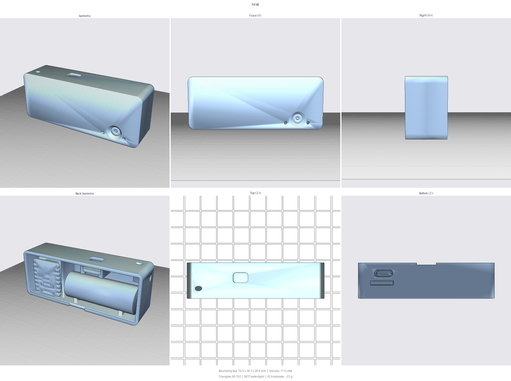

# kukucs

A one-button keychain camera built on the Seeed XIAO ESP32-S3 Sense ("kukucs" is Hungarian for peekaboo).
It sleeps all the time, wakes for one click, and serves its photos from its own Wi-Fi hotspot.



## Features
- Deep sleep between shots; short press = photo (~1 s shutter lag), with a small thumbnail for the gallery.
- Long press = Wi-Fi hotspot with a phone gallery that pops up by itself: grid, full-screen view with swipe,
  select several photos to save as one zip or delete, a remote **Take photo** button, auto-refresh.
- Photos named by date (`kukucs_2026-11-04_191502.jpg`): the phone sets the camera's clock when the gallery opens.
- microSD card when one is in, internal flash otherwise; photos move to the card once one appears.
- USB drive mode: plugged into a PC, a short press shows the card as a drive.
- Camera sensor put into standby before sleep; the orange LED flashes as a heartbeat in hotspot mode and after each photo.
- A 3D-printable case (CadQuery), checked for collisions against Seeed's official board model.

## Hardware
- Seeed Studio XIAO ESP32-S3 Sense (with camera and its Wi-Fi antenna; without the antenna the range is a few cm)
- 3.7 V LiPo, here a salvaged 850 mAh cylinder cell, Ø15 × 40 mm, soldered to the XIAO's BAT pads (it charges over USB-C)
- A small tactile switch (here a salvaged 10 × 10 mm board), between **D1 (GPIO2)** and **GND**;
  the internal pull-up is used, nothing else needed
- Optional: microSD card, FAT32

## Use
- **Short press**: takes a photo, back to deep sleep.
- Picture orientation depends on how the board sits, and `src/main.cpp` has two settings for it (`EXIF_ORIENTATION`: a
  tag that asks viewers to turn the picture, pixels untouched; `SENSOR_ROTATE_180`: a free half turn in the sensor).
  Measured: held like it sits in case v5 (USB-C pointing down, lens away from you), pictures come out upright and
  landscape with no turn at all (`EXIF_ORIENTATION 1`, `SENSOR_ROTATE_180 false`, the default). Host test for
  the tag code: `test/exif_selftest.cpp`.
- **Long press (2 s)**: starts hotspot `kukucs` / password `kukucs123` (**change it** in `src/main.cpp` before you
  carry the camera around). The gallery pops up on the phone, or open http://192.168.4.1.
  If downloads don't start in the popup, open the address in the normal browser.
- In hotspot mode: a **short press** (or **Take photo** on the page) still takes a photo; a **long press** ends it.
  It also ends by itself after 2 min with no phone connected, or 5 min without page loads.
- **USB drive**: plug into a PC, then short press → the SD card shows up as a drive (no card: takes a photo instead).
  Eject or unplug → sleep.
- **LED** (inside the case, seen through the USB-C slot): short flash every 2 s = hotspot on; one longer flash = photo saved.
- Plugging in / reset just goes straight to sleep.
- Without a set clock (after the battery ran flat) photos are named `kukucs_00042.jpg`. The clock drifts a few
  minutes a day in deep sleep and is corrected on every gallery visit.

## Storage
- **microSD card in** (FAT32 only, exFAT is not supported; cards up to 32 GB come as FAT32): 1600×1200 photos.
- **No card**: photos go to internal flash at 800×600 (about 30 fit). The gallery shows an orange
  "No SD card · internal memory" badge. Once a card is in, these photos move to it the next time you open the
  gallery or the USB drive (each is deleted from flash only after it is safely on the card).
- The card is checked on every wake, so it can be swapped any time.
- Format a big card on Linux (erases it, check the device name first): `sudo mkfs.vfat -F 32 -n KUKUCS /dev/sdX1`

## Build & flash
```bash
pipx install platformio
```
| Environment | Notes |
|---|---|
| `xiao` (default) | the camera |
| `test` | never sleeps; serial `s` = short press, `l` = long press, `d` = USB drive |

```bash
pio run -t upload
```
While the board is awake (hotspot, USB drive, or the `test` build), this flashes with no buttons: PlatformIO resets it
through the USB serial port (1200-baud trick). While it sleeps, start the hotspot first (long press), or hold
**BOOT**, tap **RESET** (only reachable with the SD card out), release BOOT, upload, press RESET.

USB runs on TinyUSB, so the board shows up as Seeed `2886:0056` (and as Espressif `303a:1001` while in flash mode).
On Linux both need a udev rule, e.g. in `/etc/udev/rules.d/99-esp32.rules`:
`SUBSYSTEM=="tty", ATTRS{idVendor}=="303a", MODE="0666"` and the same line with `2886`.
`pio device monitor` shows logs (and sends the fake presses in the `test` build); closing it no longer resets the board.

Zip writer self-test (host): see the top of `test/zip_selftest.cpp`.

SSID, password, resolution, timings are `#define`s at the top of `src/main.cpp`; the gallery page is `src/page.h`.

## Case
Current: `case/v5/` (CadQuery), 70.5 × 27.7 × 19.7 mm. The board is turned so the sensor's wide side runs left-right and
the pictures come out **landscape**. Seen from the front: the board is on the right with the lens in the lower right, the
battery lies along the bottom on the left with the shutter button on top of it, and the **USB-C port and the microSD slot
are in the bottom wall**. Older versions are kept for reference: `v4/` (portrait photos, USB-C in the side wall), `v3/`,
`v2/`, `v1/`. Print v5.

v5 files: `body.stl`, `lid.stl`, `cap.stl` (print orientation), `case_assembled.step`, `drawing.png` (dimensions),
`antenna_route.png` (where the antenna strip and its cable go).
Positions come from Seeed's official 3D model. `check_fit.py` tests the board, battery, button PCB, body, lid and cap
against each other, plus the paths for putting the board and the button board in, and the wire routes.

Change a number at the top of `case/v5/model.py`, then (needs `pip install cadquery`):
`python model.py` and `python check_fit.py "Seeed Studio XIAO-ESP32-S3-Sense.step"`.

Print: PLA, 0.2 mm layers, 3 walls, 15 % infill, no supports. Body front-face down, lid plate down, cap flange down.

Nothing is glued, so every part can move to a new case version:
1. Cap (rounded rectangle, so it can't turn) into the top hole from inside; its flange keeps it in.
2. Button PCB, switch up, slides into its rails under the top wall from the back (above the battery); small crush ribs
   on the rails hold it by friction (there is no lid tab: that part of the lid is for the antenna).
3. Battery lies in the cradle on the bottom left, a wire at each end.
4. Board, **microSD card out** and the antenna plugged onto the u.FL first: in from the back **raised about 1.8 mm**,
   slide it forward until the lens barrel meets the front wall, then lower it so the USB-C seats in its slot in the
   floor. Then push the card in through its slot from outside.
5. Stick the antenna strip (flat FPC, 40 × 20 mm) on the inside of the lid, left half, with the strip's cable end at its
   top-right corner; lay the cable as in `antenna_route.png` (see below).
6. Snap the lid on: its ribs press the board forward, and its tab above the board stops it lifting out of the USB-C slot.
   Fingernail notch at the bottom back edge to open it.

Wiring routes (checked in `check_fit.py`): the 2.5 mm gap between the XIAO's back and the lid, and a 3 mm gap right of the board.
- Battery → BAT pads on the XIAO's back (BAT− is the pad nearest USB-C). A wire at each end: both run along the back of the
  battery at mid height, then to the board.
- Shutter button → D1 and GND: solder the wires to the switch's two metal end tabs (front side; the salvaged
  board has no pads on the back) and cut the two traces leading away from the switch. The wires leave over the top
  of the button PCB, run across the back of the board under the tab above it, and drop along the board's two side edges
  to D1 and GND (the 2nd pin from the USB-C end on each edge, soldered on the back face).
- Antenna (Seeed's flat FPC antenna: strip 40 × 20 mm, coax 1.13 mm × about 80 mm): plug it onto the u.FL before the board
  goes in, turning the plug so the cable leaves towards the board's right edge. The cable goes out through the gap between
  the two boards, turns back in the 3 mm space right of the board, then runs left across the back of the board in the
  corridor between the lid ribs and the button wires (z 17.5–20.5), about 34 mm in all, to the strip's top-right corner.
  The strip sits on the lid's left half, right behind the battery. About 23 mm of the cable is slack: take it up with an
  S-curve in the corridor.

BOOT: paperclip through the small hole left of the lens. RESET (hole right of the lens) only works with the SD card out.
Keychain: split ring or cord through the Ø2.5 tunnel in the top-left corner.
The microSD card sticks out 1.2 mm below the case; add small feet if it should stand on a table.

**Photo orientation:** held like it sits in this case (USB-C down, lens away from you) the pictures come out upright and
landscape with no setting at all (`EXIF_ORIENTATION 1`, `SENSOR_ROTATE_180 false`, the firmware's default).

## Project layout
| Path | What |
|---|---|
| `src/main.cpp` | firmware: sleep, camera, storage, hotspot, web API, USB drive |
| `src/page.h` | the gallery page (HTML/CSS/JS in one string) |
| `src/zipstream.h` | streaming zip writer used for downloads |
| `test/zip_selftest.cpp` | host test for the zip writer |
| `case/v5/` | current case: `model.py` (CadQuery), STLs, STEP, dimensioned drawing, `check_fit.py` |
| `case/v1`–`v4` | earlier case versions, kept for reference |

## Not tested yet
- The case: v5 hasn't been printed; snap fit, button travel, keychain strength, the plug clearance and the friction lock of
  the button PCB need a test print. The antenna sits right behind the metal battery, so expect less Wi-Fi range than in the open.
- How much the camera standby lowers the deep-sleep current (measure it with a multimeter in series with the battery).
- USB drive mode reads the card fine, but after leaving it the laptop resets the camera's USB link for up to a minute
  (it recovers by itself), and a plain eject needs root. A long press on the camera leaves drive mode.
- Photo orientation in the v5 pose (USB-C down): calculated from the v4-pose test, not yet tried.

## License
MIT, see [LICENSE](LICENSE). Covers the firmware and the case design.
